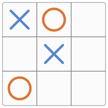
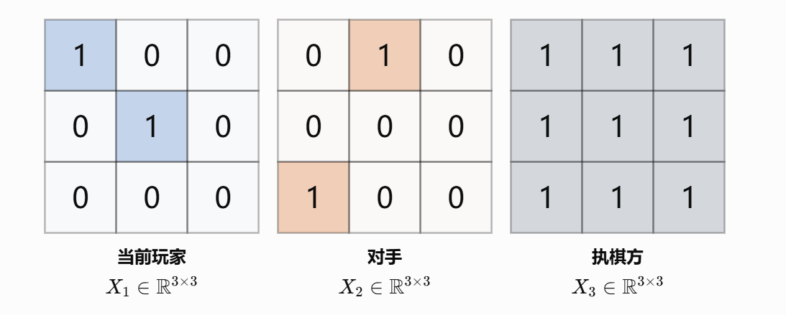
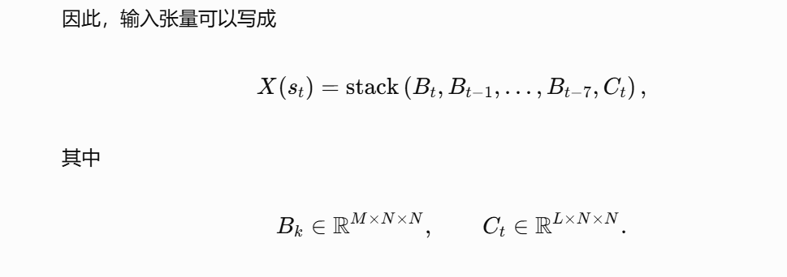
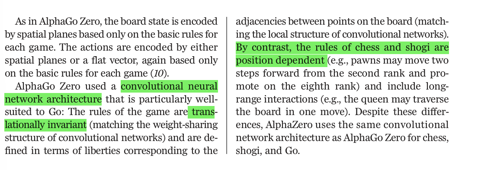
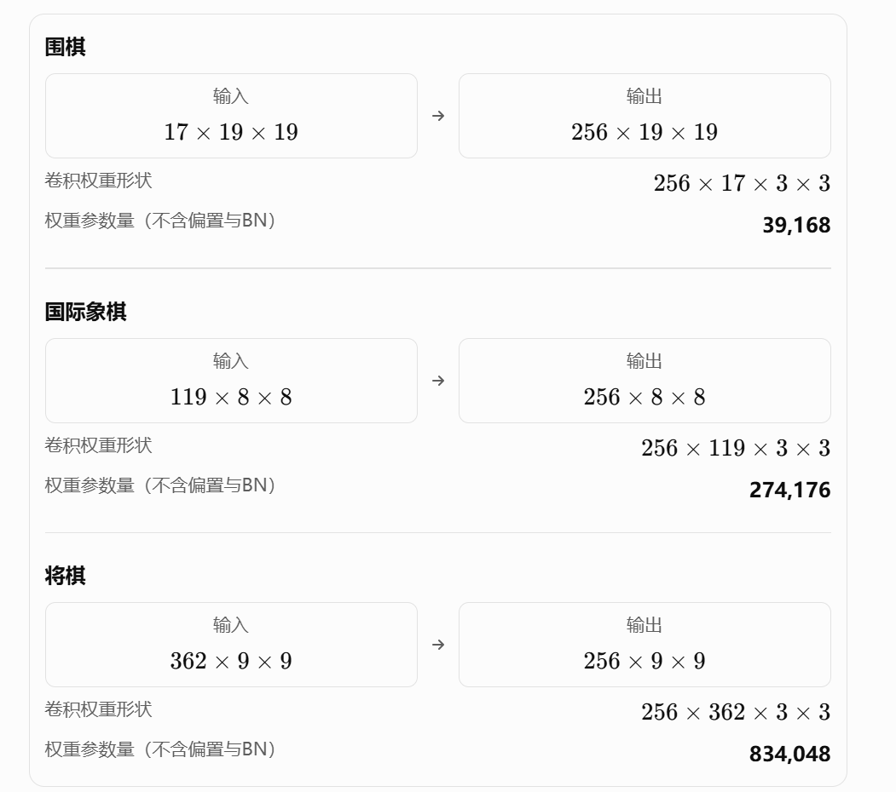
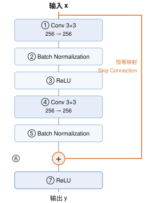
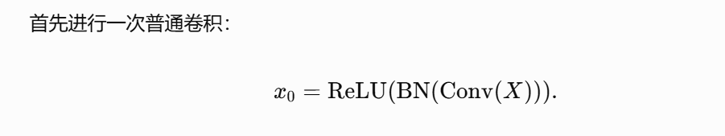
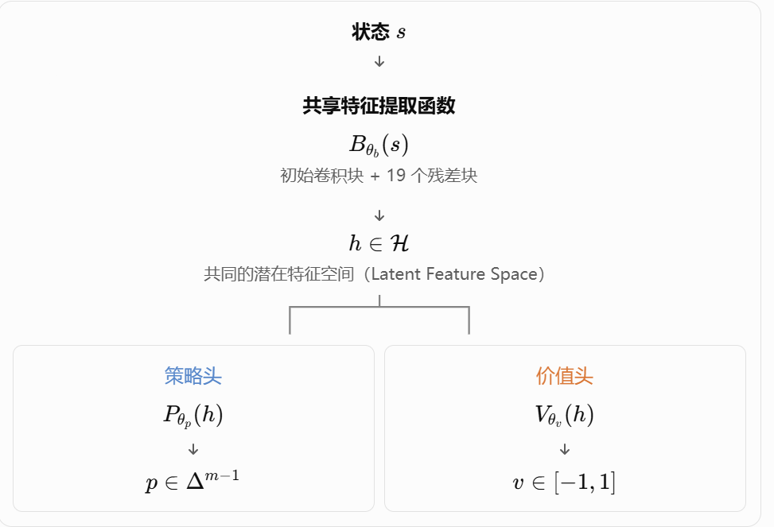

## 参考资料：

《AlphaZero》原论文
AlphaZero 补充资料

# 总纲

神经网络部分模拟的是这个函数：
$$
	f_{\theta}(s)=(p,v)
$$
其中 
- $\displaystyle \theta$ 是神经网络需要模拟的参数
- s 是输入的棋局状态
- p 是在网络输出的棋局状态下一步走子的概率，并不代表赢棋概率
- v则是网络预测的本状态价值函数
p,v也是强化学习框架下我们最关注的问题。
神经网络的数据来自自我博弈产生的棋局数据，而神经网络又反过来要引导MCTS搜索的过程。为什么要用神经网络去做这个预测，原因是
- 搜索空间太大，且难以估计
- 泛化问题

AlphaZero使用的神经网络分为四个部分：
- 状态编码，将抽象空间转化为数值张量
- CNN，卷积神经网络，提取棋盘的空间特征
- ResNet,构成残差卷积神经网络，构造和训练深层特征提取逻辑
- Dual-head，双头结构，利用共享特征，能够同时预测策略和价值


其中全部可训练参数为$\displaystyle (\theta _{b},\theta _{p},\theta _{v})$

# 状态编码与张量

主要参考两份原始资料：

- AlphaZero 补充材料：PDF 第 5—6 页的 Representation，以及第 14 页的 Table S1、S2。
- AlphaGo Zero 原论文：Methods 中的 Neural network architecture。

>如何保存棋局状态 s
>以及如何保存神经网络输出的概率


神经网络输出的部分如下：
- $\displaystyle p_{\theta}(a|s)$:动作概率
- $\displaystyle v_{\theta}(s)$： 状态函数

**神经网络的结构**如下：
$$
	\mathcal{f}_{\theta}:\mathcal{S}\to \Delta^{m-1}\times[-1,1]
$$
其中$\displaystyle \mathcal{S}$是状态空间，m是固定动作编码空间的大小，$\displaystyle \Delta^{m-1}$是概率单纯形

我们首先要做的第一件事情是确保$\displaystyle \mathcal{S}$ 状态空间是可以计算的欧式空间$\displaystyle \mathbb{R}^{d}$ （张量也看做欧式空间），更准确的形式是$\displaystyle \mathbb{R}^{C\times H\times W}$ 。
C表示通道数，$\displaystyle H\times W$表示对应游戏棋盘大小。我们将在之后进行详细的解释。

## 状态编码——井字棋

其实本质上状态编码是一个新的映射，$\displaystyle \mathcal{S}\to \mathcal{S'}$。然后再对$\displaystyle \mathcal{S'}$进行 $\displaystyle f_{\theta}$ 神经网络计算。但为了方便表示，我们对$\displaystyle \mathcal{S}$进行状态编码后仍然记为 $\displaystyle \mathcal{S}$ 

我们先通过最简单的井字棋的例子来理解如何编码成 $\displaystyle \mathbb{R}^{C\times H\times W}$



这是一个井字棋。当前的玩家是 :X,对手是 :O

### 单通道编码

我们想对这个状态进行编码，有一种简单的方式是规定
$$
	\begin{cases}
	1 \quad \text{当前位置是}X \\
	-1 \quad \text{当前位置是} O \\
	0 \quad \text{当前位置无棋子}
	\end{cases}
$$
从而得到一个矩阵
$$
	B= \begin{pmatrix} 1 & -1 & 0 \\ 0 & 1 & 0 \\ -1 & 0 & 0 \end{pmatrix}
$$

这一个矩阵蕴含两类信息，X方棋子位置：
$$
	B_{1}=\begin{pmatrix}
	1 & 0 & 0\\0 & 1 & 0\\ 0 & 0 & 0
	\end{pmatrix}
$$
O方棋子位置：
$$
	B_{2}=\begin{pmatrix}
	0 & 1 & 0 \\0 & 0 & 0\\1 & 0 & 0
	\end{pmatrix}
$$
$\displaystyle B=B_{1}-B_{2}$
这样编码的问题是

1.**权重关联性**
之后要进行卷积运算
$\displaystyle K*B=K*B_{1}-K*B_{2}$
则我方棋子权重和对方棋子权重具有相反关系。我们希望的神经网络不必保持两类棋子的权重具有某种关联性，使得可以学习更加灵活的特征组合。
在卷积运算中，我们希望每个输入通道能够具有独立的权重平面。

2.**视角分裂**
我们没有必要学习X方如何获得胜利，O方如何获得胜利，而可以统一为我方如何获得胜利。

### 多通道编码

我们采取多通道编码。仍然对于上述井字棋例子。我们定义三个特征平面。注意，这里仅仅是举的井字棋的简单例子，之后可能会多个平面，但是重点是三方视角记录。

- 第一个平面记录**当前玩家的棋子**
- 第二个平面记录 **对手的棋子**
- 第三个平面记录当前下棋方的绝对身份，例如规定X下棋时所有元素为1，O下棋时所有元素为0
对于原来的$\displaystyle 3\times{3}$ 井字棋的例子。有


最终三个平面叠加得到三通道井字棋编码。

**AlphaZero的补充材料也明确说明，棋盘表示以当前玩家为视角，并分别用不同的特征平面表示我方棋子和对方棋子**
## 一般棋局

上面的井字棋因为游戏规则简单，所以结构也简单。我们回到AlphaZero状态的编码，在补充材料Representation 一节中给出了统一的输入形式：
$$
	X(s)\in \mathbb{R}^{(MT+L)\times N\times N}
$$
原文如下
```
The input to the neural network is an N ×N ×(MT+L) image stack that represents state using a concatenation of T sets of M planes of size N × N.
```

其中参数含义如下：
- N表示棋盘边长
- M表示每个历史时刻的特征平面数
- T表示历史时刻，原论文取8
- L表示额外的当前状态特征平面数

### 历史状态

是的，对于一个状态的编码，我们不仅要考虑当前状态，还要考虑历史状态。
因为我们之前学习强化学习的一个大类是马尔可夫过程，它的动力函数是
$$
	P(R_{t+1},S_{t+1}|S_{t}=s,A_{t}=a,S_{t-1},A_{t-1}\dots S_{0},A_{0})=P(R_{t+1},S_{t+1}|S_{t}=s,A_{t}=a)
$$

但是在一般的强化学习中并不是这样，比如围棋中有劫的说法，需要考虑之前是否出现相同的局面，等等。

我们之后依然以围棋为例来考虑输入编码

### 围棋

围棋的通道数是$\displaystyle 17\times 19\times 19$。后面两个19表示的是棋盘大小不必多说。
17分解为$\displaystyle (2\times{8}+1)$
其中
- 每个历史时刻有两个特征平面：当前方和对手方（见井字棋例子）
- 然后总共8个时刻
- 1个记录当前方颜色的特征平面（见井字棋例子）

其实可以按照时间进行拆分,这不是重点。



另外国际象棋是$\displaystyle 119\times 8\times 8$。其中$\displaystyle 119=14\times 8+7$


## 动作空间的编码

我们还需要考虑网络输出的策略向量的编码：
$$
	p_{\theta}(s)=(p_{1},p_{2}\dots p_{m})
$$
表示各个动作的预测概率，这还用单独说明吗？当然，因为有一个问题，不同局面可以考虑的合法动作是不一样的，但是神经网络具有固定的输出维度，存在动作对应问题和神经网络训练问题。

聪明的读者已经想到，虽然不同局面合法动作不一定一样但是总动作是一样的啊，棋盘有多大就有多少动作。那么我们预测所有动作然后选出合法动作即可。

以井字棋为例：
**神经网络始终输出九个分量。随后通过合法动作掩码（Legal Action Mask），将非法动作概率置零，再重新归一化。**

这里用到动作的试验函数：
$$
	m_{a}(s)=1_{a\in A(s)}
$$
则相应的输出概率是
$$
	p_{a}'=\frac{m_{a}(s)p_{a}}{\sum_{b} m_{b}(s)p_{b}}
$$

判断过程是由游戏规则和一个确定的数学运算完成的，不需要神经网络自己通过训练发现哪些走法合法。


# 卷积神经网络

>三大网络之一，提取棋盘特征

- AlphaZero
- AlphaZero 补充材料

补充材料-结构中提到
```
Each convolution applies 256 filters of kernel size 3 ×3 with stride 1
```


### 为什么用卷积神经网络

一般的全连接神经网络把棋盘多通道向量展成一维向量，不但参数量巨大（$\displaystyle 19\times 19$就有361个参数，而且还有通道）。最重要的问题是 全连接层没有主动利用棋盘的空间结构。
==神经网络最重要的思想就是要主动设计网络使其能更好地利用特征==

而CNN在Go中有两个对应的性质
- 局部连接，局部棋子之间存在关联
- 权重共享，相似棋形在不同位置具有共性

原论文描写如下：

作者承认CNN是由于AlphaGoZero 使用卷积特别符合Go，由于具备某种平移不变性和对称性。国际象棋没有那么符合CNN，它们位置相对是对立的。但是也采取相同的结构。

详细看 11 视觉问题的特点与卷积操作

卷积之所以有用是因为局部共享卷积参数，所以不同棋局卷积操作之后能够产生不同的反应，可以反映某些更本质的特征。

### 参数设置

AlphaZero人为规定
- Stride=1.步长，即每次在空间中移动的距离。这里1表示不跳跃
- 卷积核的尺寸是$\displaystyle 3\times{3}$.
- 填充1，外围填充。保证卷积前后棋盘空间大小不变（为残差块相加服务）
- 卷积的通道数和输入参数保持一致，也就是$\displaystyle MT+L$
关于卷积的过滤器数目，规定是256个，也就是最终输出256个输出通道。
比如围棋的输入是
$$
	X\in \mathbb{R}^{17\times 19\times 19}
$$
有17个输入通道和256个输出通道，所以实际的权重张量为
$$
	W\in \mathbb{R}^{256\times 17 \times{3} \times{3}}
$$

其他类似卷积核的权重和实际提取的特征由训练学习得到。

深度学习不再手动进行特征工程就是因为，**而且，实际深层网络中的某个特征通道不一定能够被人类解释为一个明确的棋艺概念。许多信息可能以分布式的方式编码在多个通道中**



### 是否能够判断整个棋局

这是CNN的感受野的回答，不多阐述，总的来说，不断增加卷积层，则一个输出元素可以覆盖整个围棋盘

**通过多层卷积与非线性映射，网络能够逐步扩大感受野并学习复杂的棋盘特征。**

# 残差神经网络 ResNet

我们用的神经网络有很多层，AlphaZero 的网络主体有整整39个卷积层。整体上很有可能出现梯度爆炸或者消失的问题。而且增加网络层数后，即使模型理论上具有更强的表示能力，其训练误差也可能反而增大。

所以实际上我们使用的是具有残差结构的深层卷积神经网络。多层残差神经网络在卷积神经网络的基础上修改，一般形式是
$$
	x_{l+1}=x_{l}+F_{l}(x_{l})
$$
不需要重新构造特征，最终前向传播的形式为
$$
	x_{L}=x_{0}+\sum_{i=1}^{L-1}F_{l}(x_{l}) 
$$


还有两个工具
- 多批次正则化
- 激活函数ReLU
主要是为了保证学习过程的多样性和效果。

整体结构如下，这是一个残差网络主体的一个残差块


这里不要混乱：
我们为了教学把卷积层和残差层分开，但是它们是一体共同训练的，并非分离或者前后顺序。除了初始卷积层外，总共有19个上述单元残差块，所以卷积层总共39个。



# 双头结构
>共享神经网络

我们用神经网络拟合的是自我博弈产生的两种数据
- $\displaystyle \pi$，策略是通过MCTS搜索得到的
- $\displaystyle v$，状态的价值是自我博弈（也是根据MCTS搜索得到的策略）的结果回溯得到的价值函数

在最初的AlphaGo中，策略网络和价值网络是两个独立的网络

分别记为
$$
	p_{\alpha}:\mathcal{S}\to \Delta^{m-1}
$$
$$
	v_{\beta}:\mathcal{S}\to [-1,1]
$$
参数$\displaystyle \alpha,\beta$ 分别代表两个网络

到了AlphaGo Zero(2017) 变成一个神经网络：
$$
	f_{\theta}(s)=(p,v)
$$

整个AlphaZero 神经网络部分的参数分为三个部分：
$$
	\theta=(\theta _{b},\theta _{p},\theta _{v})
$$
其中$\displaystyle \theta _{b}$ 代表的是共享网络主体，称为 Body。

### 为什么共享参数

因为很多情况下下一步应该走哪里（策略预测）和当前局势如何（价值预测）所需要的信息是共同的，
特别是“存在一步制胜机会”这一特征，同时能够帮助我们选择动作和评估局面。没有必要构造两个神经网络去识别特征。我们可以只提取一次，然后交给两个不同的输出模块进行处理。

也就是去成立一个中转站，然后策略和价值分别从中转站中提取自己想要的。

## 共享参数

共享神经网络的数学实体依然是复合函数：
共享特征提取函数：
$$
B_{\theta _{b}}:\ \mathcal{S}\longrightarrow \mathcal{H}.
$$

策略预测函数：
$$
P_{\theta _{p}}:\ \mathcal{H}\longrightarrow \Delta^{m-1}.
$$

价值预测函数：
$$
V_{\theta _{v}}:\ \mathcal{H}\longrightarrow [-1,1].
$$

整个神经网络就是
$$
\begin{cases}
h=B_{\theta _{b}}(s),\\
p=P_{\theta _{p}}(h),\\
v=V_{\theta _{v}}(h).
\end{cases}
$$

或者写成复合映射：
$$
f_{\theta}(s)=
\begin{pmatrix}
P_{\theta _{p}}\circ B_{\theta _{b}}(s)\\
V_{\theta _{v}}\circ B_{\theta _{b}}(s)
\end{pmatrix}.
$$

整体结构如下图



**共享的不是输出，也不是整个策略函数与价值函数，而是两个函数的中间特征表示和生成这些特征的参数。**

两个输出头仍然拥有各自独立的参数，因此完全可以实现不同的数学映射

## 联合损失函数

我们用神经网络拟合的是自我博弈产生的数据，
- $\displaystyle \pi$，策略是通过MCTS搜索得到的
- $\displaystyle v$，状态的价值是自我博弈（也是根据MCTS搜索得到的策略）的结果回溯得到的价值函数。其实就是最终博弈结果z以当前玩家视角表示
- s，当前局面

预测
$$
	(p,v)=f_{\theta}(s)
$$
分别构造策略损失和价值损失
$$
	L_{p}=-\sum_{a} \pi _{a}\log p_{a}
$$
这是比较经典的熵损失作为代价函数。
$$
	L_{v}=|z-v|^{2}
$$
整体损失函数为
$$
	L=L_{p}+L_{v}+c\|\theta\|^{2}
$$

最后一项是正则项，限制参数，防止过拟合现象
求梯度其实就是链式法则反向过程了，属于代码实验问题不多赘述。


